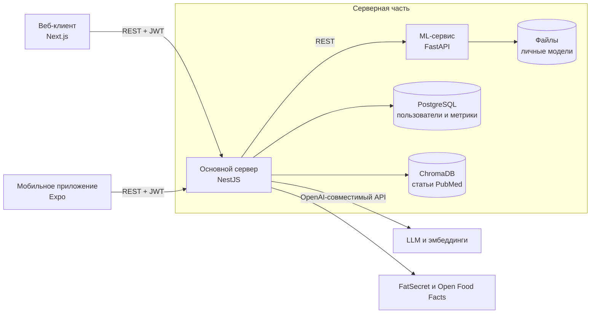

# Low Cortisol

Система собирает данные о сне, настроении, стрессе, активности, воде и питании и находит связи между ними. На этой основе она строит личный прогноз настроения и объясняет, какие факторы на него повлияли. Рекомендации опираются на правила, персональную ML-модель и LLM со ссылками на научные статьи PubMed.

Это выпускная квалификационная работа, МГТУ им. Н. Э. Баумана, 2026.

*English summary: a multimodal health-tracking system with a NestJS API, a FastAPI ML service, personal mood models with SHAP explanations, and LLM recommendations backed by RAG over PubMed. It runs with one Docker Compose command and works without paid API keys in demo mode.*


## Архитектура



Как формируется рекомендация:

1. Основной сервер собирает метрики пользователя из PostgreSQL.
2. Правила и детектор причинно-следственных цепочек находят проблемы и закономерности.
3. ML-сервис обучает личную модель и возвращает прогноз настроения с вкладом факторов по SHAP.
4. RAG подбирает подходящие статьи PubMed.
5. LLM формирует текст рекомендаций, а сервер проверяет ссылки на статьи и опасные формулировки.

Если ML-сервис или LLM недоступны, пользователь всё равно получает рекомендации по правилам.

Подробный разбор с числовым примером находится в [docs/recommendation-flow-diagram.md](docs/recommendation-flow-diagram.md).

## Стек

| Часть | Технологии |
|---|---|
| Основной сервер | NestJS, TypeScript, TypeORM, ts-rest, JWT, Pino |
| ML-сервис | Python, FastAPI, scikit-learn (Ridge, Gradient Boosting), SHAP, faster-whisper |
| Данные | PostgreSQL 16, ChromaDB |
| Веб-клиент | Next.js, React, TypeScript |
| Мобильное приложение | Expo, React Native |
| LLM | OpenAI-совместимый API, Structured Outputs, RAG |
| Инфраструктура | Docker Compose, pnpm workspaces |

## Запуск

Нужен Docker с Docker Compose. Для первой сборки требуется несколько гигабайт на диске.

```bash
git clone https://github.com/Sorrik/low_cortisol.git
cd low_cortisol
cp .env.example .env
docker compose up -d --build
docker compose exec backend pnpm seed:demo
```

| Адрес | Что открывается |
|---|---|
| http://localhost:3001 | Веб-клиент |
| http://localhost:3000/api/docs | Swagger основного сервера |
| http://localhost:8000/docs | Swagger ML-сервиса |

Демо-пользователи синтетические, у всех пароль `Test1234!`. Попробуйте `masha@test.local`, `andrey@test.local` или `dima@test.local`, всего их десять, список есть в [seed-test-users.ts](backend/src/seed/seed-test-users.ts).

### Демо-режим и полный режим

Без `OPENAI_API_KEY` работают метрики, правила, ML-прогноз и SHAP. Текст от LLM, RAG, распознавание еды по фото и голосовое заполнение форм отключены.

Чтобы включить всё, укажите ключ в `.env` и загрузите статьи. Скрипт скачивает их из PubMed и считает эмбеддинги, это платный вызов API.

```bash
docker compose up -d backend
docker compose exec backend pnpm seed:rag
docker compose restart backend
```

### Мобильное приложение

Телефон должен быть в одной сети с компьютером. В `mobile/.env` укажите адрес компьютера в локальной сети.

```bash
cd mobile
cp .env.example .env
npm ci
npm start
```

## Примеры запросов

```bash
# Вход
curl -X POST http://localhost:3000/auth/login \
  -H "Content-Type: application/json" \
  -d '{"email":"masha@test.local","password":"Test1234!"}'

# Прогноз, факторы и рекомендации
curl http://localhost:3000/insights/me \
  -H "Authorization: Bearer <access_token>"
```

Сокращённый ответ `GET /insights/me`:

```json
{
  "phase": { "mode": "learning", "total_records": 14, "records_needed": 36 },
  "predicted_mood": 8.1,
  "confidence_lower": 7.3,
  "confidence_upper": 8.9,
  "top_influencers": [
    { "factor": "dow_cos", "impact": 0.04, "direction": "positive", "description": "День недели улучшает настроение на 0.04" }
  ],
  "recommendations": [ "..." ]
}
```

## Тесты

```bash
# Основной сервер: юнит-тесты и e2e авторизации
corepack enable
pnpm install
pnpm test

# ML-сервис
docker compose exec ml-service pytest
```

## Данные и лицензия

Все пользователи и метрики в проекте синтетические. Обученные модели и тексты статей PubMed не хранятся в репозитории. Модели создаются во время работы, а статьи скачиваются скриптом.

Лицензия не указана: код открыт для просмотра, но все права на него сохраняются за автором.
