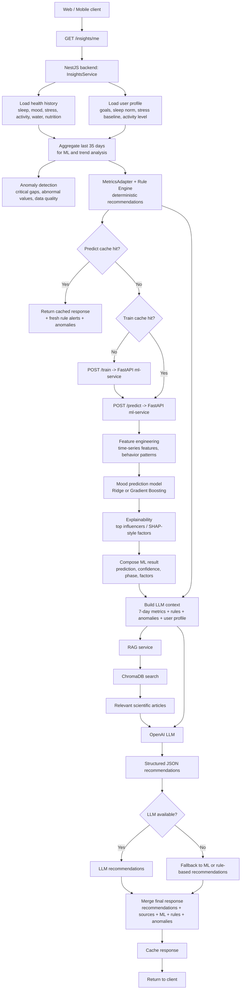

# Block Diagram Of Recommendation Pipeline

Ниже приведена блок-схема работы системы рекомендаций. Ее можно вставлять в курсовую как описание технического контура формирования персональных рекомендаций.

Короткое пояснение для текста отчета:

1. Клиент запрашивает `GET /insights/me`.
2. Backend собирает историю данных пользователя и его профиль.
3. На backend рассчитываются аномалии и rule-based рекомендации.
4. Далее backend обращается к `ml-service` для обучения при необходимости и для предсказания настроения.
5. ML-слой строит признаки, вычисляет прогноз и факторы влияния.
6. Backend формирует расширенный контекст для LLM, включая правила, метрики, профиль и ML-факторы.
7. RAG-слой при наличии получает релевантные научные статьи из `ChromaDB`.
8. LLM формирует персональные рекомендации в структурированном JSON.
9. Если LLM или ML недоступны, система деградирует в fallback-режим и использует rule-based или ML-советы.
10. Итоговый ответ кэшируется и возвращается в web/mobile клиент.
