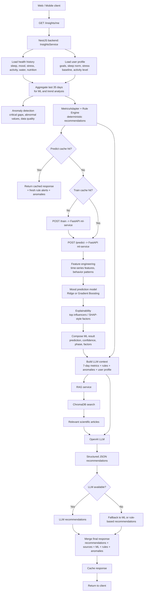

# Как формируется рекомендация

Ниже приведена блок-схема работы системы рекомендаций. Ее можно вставлять в курсовую как описание технического контура формирования персональных рекомендаций.



Короткое пояснение для текста отчета:

1. Клиент запрашивает `GET /insights/me`.
2. Backend собирает историю данных пользователя и его профиль.
3. На backend рассчитываются аномалии и rule-based рекомендации.
4. Далее backend обращается к `ml-service` для обучения при необходимости и для предсказания настроения.
5. ML-слой строит признаки, вычисляет прогноз и факторы влияния.
6. Backend формирует расширенный контекст для LLM, включая правила, метрики, профиль и ML-факторы.
7. RAG-слой при наличии получает релевантные научные статьи из `ChromaDB`.
8. LLM формирует персональные рекомендации в структурированном JSON.
9. Если LLM или ML недоступны, система деградирует в fallback-режим и использует rule-based или ML-советы.
10. Итоговый ответ кэшируется и возвращается в web/mobile клиент.

---

## Как именно субъективная метрика влияет на рекомендацию (сквозной числовой пример)

Это раздел отвечает на вопрос «как qualitative-метрика типа `sleep_quality` превращается в конкретную рекомендацию пользователю». Ниже — реальная цепочка для пользователя, который месяц проставляет качество сна 4–5/10.

### Входные данные

История за 30 дней, последний день — сегодня:
- `sleep.quality` — стабильно 3–5/10 (среднее ≈ 4.2, std ≈ 0.6).
- `sleep.duration_hours` — 7.0 ± 0.8 (то есть человек спит достаточно долго, но субъективно ему кажется плохо).
- `mood`, `stress`, `activity` — в пределах нормы.

### Шаг 1 · Feature engineering ([ml-service/app/services/feature_engineering.py](../ml-service/app/services/feature_engineering.py))

Из истории строится 30+ фичей. Релевантные для нашей цепочки:

| Фича                                | Значение |
|-------------------------------------|----------|
| `sleep_quality_t`                   | 4.0 (сегодня) |
| `sleep_q_baseline_30d_mean`         | 4.2 (личная норма) |
| `sleep_q_baseline_30d_std`          | 0.6 |
| `sleep_q_baseline_30d_samples`      | 30 |
| `sleep_q_z_t`                       | (4.0 − 4.2) / max(0.6, 0.5) ≈ −0.33 |
| `chronic_low_sleep_q_4d`            | 1.0 (последние 4 ночи ≤4/10) |
| `chronic_baseline_sleep_q_low`      | 1.0 (личная норма ≤4.5/10) |

Z-score **сам по себе** не пробит (|−0.33| < 1.5), но обе абсолютные оси сработали: и chronic_4d, и chronic_baseline.

### Шаг 2 · Dual-axis rule engine ([ml-service/app/services/recommendations.py](../ml-service/app/services/recommendations.py))

Правило `_sleep_q_dual_axis(feats)` объединяет оси по OR. Так как `chronic_baseline_sleep_q_low == 1.0`, выбирается ветка `sleep_q_chronic_baseline` (она приоритетнее, чем chronic_4d):

```python
Recommendation(
    metric="sleep",
    severity="alert",
    title="Качество сна стабильно низкое (твоя норма ≈ 4.2/10)",
    description="За 30 дней среднее качество сна 4.2/10 — это уже не ...",
    rule_id="sleep_q_chronic_baseline",
    trigger_signal=TriggerSignal(
        source="rule",
        metric="sleep",
        current_value=4.0,
        personal_baseline=4.2,
        z_score=-0.33,
        confidence="high",   # samples=30 ≥ 21
    ),
)
```

### Шаг 3 · ML модель ([ml-service/app/services/model_runtime.py](../ml-service/app/services/model_runtime.py))

Модель Ridge/GBR обучается на тех же фичах; `sleep_quality_mean` среди фичей с заметным SHAP-вкладом. В `top_influencers` появляется запись для `sleep_quality_mean` со SHAP ≈ −0.6 (снижает прогноз настроения). При этом `model_meta` возвращается с `cv_status="ok"`, `cv_mae=0.7`, `baseline_mae=1.1`, `improvement_mae_pct ≈ 36` — то есть Ridge реально обходит lag-1 baseline.

### Шаг 4 · Backend оркестрация ([backend/src/insights/insights.service.ts](../backend/src/insights/insights.service.ts))

InsightsService:
1. Получает Python-рекомендации (включая dual-axis) и ML-предсказание.
2. **ConsistencyService** проверяет расхождения — здесь его нет (`quality=4` совпадает с тем, что человек спит 7ч и стабильно жалуется).
3. **`_assignRecommendationIds`** ставит стабильный id `sleep_q_chronic_baseline-2026-05-03`.
4. **`_extractModelMeta`** прокидывает `cv_status / cv_mae / baseline_mae / improvement_mae_pct` в ответ.
5. **Structured trace log** пишет одной строкой:
   ```
   [trace] user=42 {"phase":"personal","ml":{"predicted_mood":6.4,"model_meta":{"cv_status":"ok","cv_mae":0.7,"baseline_mae":1.1,"improvement_mae_pct":36},"top_factors":[{"factor":"sleep_quality_mean","impact":0.6,"direction":"negative"}]},"consistency_flags":{},"rules_triggered":[...],"ml_rule_ids":["sleep_q_chronic_baseline"],"final_count":4}
   ```

### Шаг 5 · UI ([frontend/app/dashboard/recommendations/page.tsx](../frontend/app/dashboard/recommendations/page.tsx) / [mobile/app/(tabs)/recommendations.tsx](../mobile/app/\(tabs\)/recommendations.tsx))

Карточка рекомендации с заголовком `Качество сна стабильно низкое (твоя норма ≈ 4.2/10)` и блоком «Почему мы это советуем», который при разворачивании показывает:

- **Источник сигнала:** правило (rule_id: `sleep_q_chronic_baseline`)
- **Сейчас:** 4.0 · твоя норма за 30 дней: 4.2
- **Отклонение от нормы:** −0.33σ
- **Уверенность:** Высокая

И источник текста, и числовая основа триггера видны пользователю и комиссии.
